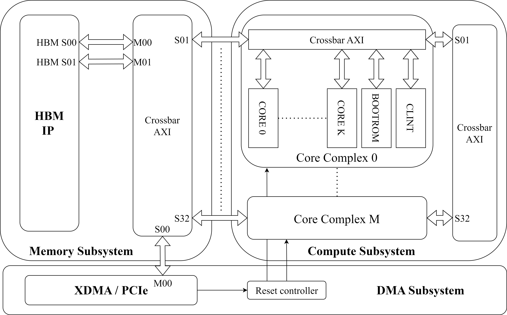

# RISCV core Cluster

This repository hosts the hardware and software for a RISCV core cluster, developed as part of my master thesis project.
It is based on the work of the PULP project, a joint effort between ETH Zurich and the University of Bologna.

The platform targets the AMD Alveo U55C: clusters of RISC-V cores (Snitch, CVA6, VeeR-EL2 or riscv-mini) share
the board HBM with the host, which loads the software payload through PCIe (QDMA) and releases the
cores from reset.

# Repository organization

## bootrom_u55
Initialization code for the riscv cores, compiled into an rtl bootrom, and its compile scripts.
`make -C bootrom_u55 CORE=<core> BUILD_DIR=<dir> all` builds `bootrom_<core>.elf/.bin/.img/.dump/.sv`
(module `bootrom_<core>`) in `<dir>`: `snitch` (rv32g), `cva` (rv64gc), `veer` (rv32imc, stack in
the DCCM), `mini` (rv32i, code at the reset pc 0x200). The top Makefile builds the bootrom of each
run in its folder, nothing is generated in `bootrom_u55`.

## hw
All the hardware of the compute platform, see [hw/README.md](hw/README.md):
- `hw/cluster`: the FPGA tops, the clock domain wrappers of the cores and the boot reset logic
- `hw/cores`: the cores (Snitch, CVA6, VeeR-EL2 and riscv-mini as git submodules) and the FPU
- `hw/infra`: AXI, APB and register interfaces, common cells and peripherals from the PULP project

## sim
Xcelium testbenches of the VeeR-EL2 (`sim/veer`) and riscv-mini (`sim/mini`) tops: the FPGA top is
simulated as is, with models of the HBM/QDMA block design and of the clock wizards (`sim/models`),
and boots a test payload from DRAM.

## sw
Git submodule with the riscv test executables, the cross compile toolchain and the host side
utilities to load the payload in the HBM.

## tcl_scripts
Vivado project generation (`create_project.tcl`), implementation (`run_impl.tcl`), clock wizards
(`gen_clock.tcl`), the QDMA + HBM block design (`qdma_interface.tcl`), the rtl filelist generator
(`filelists/gen_filelist.py`) and the flash programming script (`build_mcs.tcl`),
see [tcl_scripts/README.md](tcl_scripts/README.md).

## xdc
Alveo U55C constraints (`xdc/u55/u55_snitch_const.xdc`, shared by all the tops) and the clock domain
crossing constraints (`xdc/u55/u55_clock_domains.tcl`).

# Build
Requires Vivado 2024.2 (with the Alveo U55C board files), the riscv gcc toolchain
(`riscv64-unknown-elf-`), for riscv-mini sbt and a JDK (11 or newer, the Chisel to SystemVerilog
generation downloads its dependencies on the first run) and, for simulation, Xcelium.
Fetch the submodules first:

    git submodule update --init

Every output goes in `build/` (`BUILD_DIR=<dir>` to change it):

    make snitch | cva | veer | mini       # Vivado project in build/<core>/u55_<core>.xpr
    make bitgen [CORE=<core>] [JOBS=8]    # synthesis, implementation and bitstream of the last (or given) project
    make sim-veer                         # VeeR boot test in xcelium (bootrom -> DRAM payload, DCCM stack, DMA port, I$)
    make sim-mini                         # riscv-mini boot test in xcelium (bootrom -> DRAM payload, D$ write-back)
    make clean                            # remove build/

The clocks of the three domains (in MHz, default 50) are set when the project is created:

    make veer FREQ_CORE=80 FREQ_CLUSTER=100 FREQ_PERIPH=50

- `FREQ_CORE`: clock of every core, each core is in its own clock domain
- `FREQ_CLUSTER`: crossbar, bootrom, CLINT and HBM channel of each cluster
- `FREQ_PERIPH`: peripheral crossbar, UART, timer (and PLIC). This should be left to 50 MHz
  (`bootrom_u55/src/platform.h`)

The Vivado strategies of `make bitgen` (default: the Vivado defaults) are set with:

    make bitgen SYNTH_STRATEGY=Flow_PerfOptimized_high IMPL_STRATEGY=Performance_Explore

`make bitgen` leaves the bitstream `build/<core>/u55_<core>.bit` and the timing and utilization
reports in the same directory.

## Known good configurations
Configurations that meet timing on the whole design (setup and hold) after `make bitgen`, with
`FREQ_PERIPH=50`. Core n is `CORE_NUMBER` (cores per cluster), cluster n is `CLUSTER_NUMBER` (tops in
`hw/cluster/tops`).

| Core       | Core n | Cluster n | Core freq (MHz) | Cluster freq (MHz) | Synth strategy            | Impl strategy                  |
|------------|--------|-----------|-----------------|--------------------|---------------------------|--------------------------------|
| riscv-mini | 1      | 1         | 200             | 50                 | Vivado Synthesis Defaults | Vivado Implementation Defaults |
| riscv-mini | 1      | 1         | 250             | 250                | Flow_PerfOptimized_high   | Performance_Explore            |
| riscv-mini | 1      | 1         | 275             | 50                 | Flow_PerfOptimized_high   | Performance_ExtraTimingOpt     |
| CVA6       | 1      | 1         | 100             | 250                | Vivado Synthesis Defaults | Vivado Implementation Defaults |
| Snitch     | 1      | 1         | 50              | 250                | Vivado Synthesis Defaults | Vivado Implementation Defaults |

    make mini FREQ_CORE=200 FREQ_CLUSTER=50 FREQ_PERIPH=50 && make bitgen
    make mini FREQ_CORE=250 FREQ_CLUSTER=250 FREQ_PERIPH=50 && \
        make bitgen SYNTH_STRATEGY=Flow_PerfOptimized_high IMPL_STRATEGY=Performance_Explore
    make mini FREQ_CORE=275 FREQ_CLUSTER=50 FREQ_PERIPH=50 && \
        make bitgen SYNTH_STRATEGY=Flow_PerfOptimized_high IMPL_STRATEGY=Performance_ExtraTimingOpt
    make cva FREQ_CORE=100 FREQ_CLUSTER=250 FREQ_PERIPH=50 && make bitgen
    make snitch FREQ_CORE=50 FREQ_CLUSTER=250 FREQ_PERIPH=50 && make bitgen

## Core utilization
Post implementation utilization of one core with its clock domain wrapper (`hw/cluster/cd_wrappers`:
core, its memories, the AXI clock domain crossings and the interrupt synchronizers), from
`build/<core>/utilization.rpt`. The device totals are those of the Alveo U55C (XCU55C).

| Core       | ISA                              | Build (core / cluster MHz) | LUTs   | FFs    | RAMB36 | RAMB18 | DSP | LUTs % |
|------------|----------------------------------|----------------------------|--------|--------|--------|--------|-----|--------|
| riscv-mini | RV32I_Zicsr                      | 275 / 50                   | 4731   | 3565   | 0      | 10     | 0   | 0.36   |
| Snitch     | RV32IMAFD_Zicsr                  | 50 / 250                   | 14828  | 9907   | 12     | 0      | 15  | 1.14   |
| CVA6       | RV64IMAFDC_Zicsr_Zifencei_Zcb    | 125 / 250                  | 31311  | 14680  | 84     | 0      | 27  | 2.40   |
| VeeR-EL2   | RV32IMC_Zicsr_Zifencei_Zba_Zbb_Zbc_Zbs | 80 / 250             | 37138  | 25308  | 20     | 6      | 4   | 2.85   |
| XCU55C     |                                  |                            | 1303680| 2607360| 2016   | 4032   | 9024|        |

ISA as configured in this repository:
- riscv-mini: privileged spec 1.7 (machine mode, see [hw/README.md](hw/README.md)), no M, A, C
- Snitch: `snitch_core_axi` with RVF and RVD, M in the shared multiplier/divider, no Snitch
  extensions (DMA, SSR, FREP, IPU)
- CVA6: `cv64a6_imafdc_sv39` configuration with M, S and U modes but no MMU (`CVA6ConfigMmuPresent = 0`)
- VeeR-EL2: `VEER_CONFIG` snapshot, machine mode only (no user mode), 16 PMP entries
- A (Snitch, CVA6): the cores issue the atomics as AXI atomic operations (`aw_atop`), but the HBM
  channel ports of the block design have no `aw_atop`: an atomic to the DRAM reaches it as a plain
  write (an `axi_riscv_atomics` adapter before the HBM channel would be needed)

The rest of a 1x1 design is mostly the QDMA + HBM block design (`hbm_interface`): about 59k LUTs,
75k FFs, 81 RAMB36, 13 RAMB18 and 5 URAM, the same for every core.

Each run folder (`build/<core>` for a project, `build/sim-<core>` for a simulation) holds the
sources generated for it, rebuilt when their inputs change:
- `bootrom/`: `bootrom_<core>.elf/.bin/.img/.dump/.sv`
- `veer_snapshot/`: VeeR-EL2 configuration, from `VEER_CONFIG` in the Makefile (VeeR runs)
- `riscv_mini/`: riscv-mini `Tile.sv`, from its Chisel sources with sbt (riscv-mini runs)
